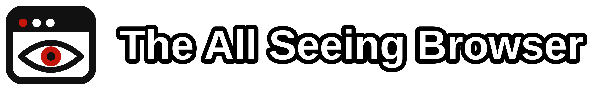

<p align="center">
  
</p>

<p align="center">
  A demo of what any web page can learn about you, most of it without asking.
</p>

<p align="center">
  <a href="https://gnhen.github.io/theAllSeeingBrowser/" target="_blank">Live demo</a> ·
  <a href="#what-it-shows">What it shows</a> ·
  <a href="#what-needs-permission-and-what-doesnt">Permissions</a> ·
  <a href="#how-to-protect-yourself">Defenses</a> ·
  <a href="#run-it-locally">Run it</a>
</p>

<!-- Add a screenshot here:  -->

## Why I built this

Every site you open can read a surprising amount about your browser, your hardware and your behavior, and almost none of it needs a permission prompt. Privacy discussions usually focus on cookies and location, but the more unknown signals (screen size, GPU, fonts, timezone, canvas rendering) are enough to tell one user from another and to track a target.

I'm a cybersecurity student, and I wanted to make this project so that you can see everything that other websites can see. The page reads everything a script can read the moment it loads and shows it in plain language, so you can see your own exposure and compare it across browsers.

## Why it matters for security

- **Tracking without cookies.** Combining many small values into a fingerprint can recognize a returning visitor even after cookies are cleared.
- **Reconnaissance.** Collecting OS, browser version, GPU and hardware details maps to MITRE ATT&CK [T1592, Gather Victim Host Information](https://attack.mitre.org/techniques/T1592/). Exploit kits have long used the same profiling to decide which payload to serve in a drive-by attack.
- **Targeted social engineering.** Knowing someone's OS, browser, language and timezone makes a phishing page easier to tailor.
- **Evasion and fraud detection.** Defenders and attackers both use these signals to spot bots, virtual machines and spoofed browsers.

## What it shows

| Area | Examples |
| --- | --- |
| Identity and browser | User agent, platform, languages, Do Not Track, automation flag |
| Time and locale | Local time, UTC offset, timezone, number and date formats |
| Screen and window | Resolution, window size, pixel ratio, color gamut, zoom estimate |
| Hardware | CPU threads, device memory, touch points, which device APIs exist |
| Graphics | GPU vendor and renderer, WebGL details |
| Network | Connection type, estimated downlink, referrer, page URL |
| Storage | Quota, usage, cookies, private-mode guess |
| Fingerprint | Canvas, audio and WebGL hashes, installed fonts |
| Extensions | Ad blocker and password manager traces, when the browser exposes them |
| Behavior (live) | Mouse position, key timing, scrolling, focus, idle time |
| Selection and clipboard (live) | What you highlight, copy, cut and paste on the page |

The top of the page turns the most important values into a short summary sentence, and everything can be filtered, collapsed, copied per card, exported as JSON or text, or printed to PDF. You can also save snapshots from different browsers and compare them.

## What needs permission and what doesn't

Showcasing what can be known about a user at different levels of notification.

**No prompt at all**

- User agent, languages, timezone and locale
- Screen, window and display settings
- CPU thread count and (in some browsers) device memory
- GPU renderer string through WebGL
- Canvas and audio fingerprints
- Clipboard contents at the moment you copy, cut or paste on the page
- Selected text, mouse movement, key timing, scrolling and tab focus

**Asks you first**

- Location
- Camera and microphone (device names stay hidden until granted)
- Notifications
- Screen capture
- Reading the clipboard outside a paste event
- Multi-monitor details

Browsers differ a lot. Firefox reports a generic GPU name (WebGL Renderer), rounds some values and blocks some API, while some Chromium-based browsers expose more. Comparing the two on the same machine is one of the most useful things this page does.

## Privacy and safety of the tool itself

- Everything runs in your browser. There is no server, no analytics and no logging.
- **One exception:** the Grab IP button sends a request to a third-party service (`api.ipify.org`) to look up your public IP. It only runs when you click it, and the header says so.
- Snapshots are stored in `localStorage` on your device until you press Clear snapshots.
- Exports and snapshots include the "Selection and clipboard" card, so anything you copied or pasted on the page will be in the file. Check before you share one.

## Limitations

- **Extension detection is heuristic.** Browsers don't expose an extension list, so the page can only notice traces such as hidden ad bait or injected elements. A missing result doesn't mean nothing is installed.
- **The fingerprint card measures signal coverage, not true uniqueness.** Real uniqueness needs a large dataset of other visitors, which this project doesn't have. Use [Cover Your Tracks](https://coveryourtracks.eff.org/) for that.
- **Some values are estimates,** including zoom, download speed and the private-mode guess.
- **Browser support varies.** Several APIs are Chromium-only, and the page leaves out anything the browser doesn't report instead of guessing.

## How to protect yourself

- Use a browser with built-in fingerprint resistance, such as Firefox with `privacy.resistFingerprinting` enabled, Brave, or Tor Browser.
- Run `uBlock Origin` and consider `CanvasBlocker` (Firefox) to block or randomize canvas reads.
- Restrict WebRTC so it doesn't reveal local addresses.
- Deny permission prompts by default and review granted permissions regularly.
- Use separate browser profiles to keep identities apart.
- Remember that blocking one signal can make you stand out more. Looking like everyone else is usually safer than looking unusual.

## Run it locally

No build step and no dependencies.

```bash
git clone https://github.com/gnhen/theAllSeeingBrowser.git
cd theAllSeeingBrowser
python3 -m http.server 8009
```

Then open `http://localhost:8009`. Serving over `localhost` gives you a secure context, which some APIs (clipboard, WebGPU, device access) require. Opening `index.html` directly works for most of the page but not all of it.

## Project structure

```
theAllSeeingBrowser/
├── index.html
├── assets/
│   ├── logo.svg
│   ├── logo.png
│   └── favicon.svg
└── src/
    ├── scripts.js
    └── styles.css
```

Plain HTML, CSS and JavaScript.


## Responsible use

This project is for education and awareness. It reads only your own browser and doesn't send anything to a server. If you host a copy, don't add server-side logging or collect other people's data without telling them clearly and getting their consent.

## Further reading

- [MITRE ATT&CK T1592: Gather Victim Host Information](https://attack.mitre.org/techniques/T1592/)
- [W3C: Mitigating Browser Fingerprinting in Web Specifications](https://www.w3.org/TR/fingerprinting-guidance/)
- [EFF Cover Your Tracks](https://coveryourtracks.eff.org/)
- [BrowserLeaks](https://browserleaks.com/)
- [MDN: Navigator](https://developer.mozilla.org/en-US/docs/Web/API/Navigator)

## License

This project is licensed under the [GNU General Public License v3.0](/LICENSE.md). Click to read more.
